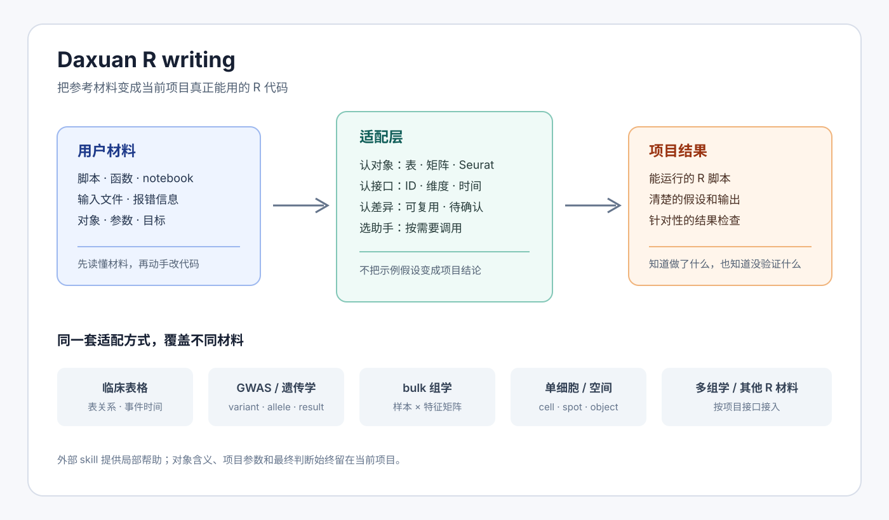
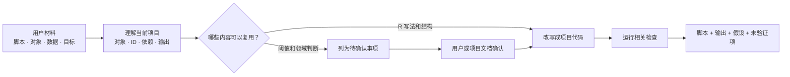

<sub>中文 · <a href="README.en.md">English</a></sub>

<div align="center">

# Daxuan R writing

> *把参考代码变成当前项目真正能用的 R 代码。*

[](SKILL.md)
[](https://skills.sh/b/DaXuanGarden/daxuan-r-writing)
[](LICENSE)

**从用户给出的数据、脚本和目标出发，写出能解释、能运行、能复查的 R 结果。**

[快速开始](#快速开始) · [我们的做法](#我们的做法) · [外部助手](#外部助手) · [验证](#验证)

</div>

---

`daxuan-r-writing` 是一个围绕项目语境组织 R 改写的 skill。它不假定用户一定使用临床表格、GWAS 或某一个分析框架，而是先理解当前材料，再把合适的代码写进当前项目。它可以处理临床、GWAS、bulk 组学、单细胞、空间组学、多组学，以及用户提供的其他 R 脚本或 notebook。



## 一眼看懂



图的重点是中间这一步：skill 不把外部代码整段搬过来，而是把可以迁移的写法接到当前项目。

## 四个动作

### 1. 先看手头的材料

用户给出的脚本、函数、notebook、示例数据和报错信息都是上下文。skill 会先找出它们实际依赖的文件、对象、包、参数和输出，而不是只根据数据领域猜一套流程。

### 2. 先保护对象的含义

临床表格要说清楚一行是什么；表达矩阵要说清楚行列分别是什么；单细胞和空间数据要确认 cell/spot、sample、feature、注释和对象类。Seurat、`SingleCellExperiment`、`SummarizedExperiment` 或自定义对象都按项目现有接口处理，不自动转置、不擅自稠密化，也不把示例阈值当成研究定义。

### 3. 只引入真正需要的助手

外部 skill 是可选工具。需要数据质量检查、表格整理、tidyverse 改写、动态列名、性能分析或出版级绘图时，才检查对应 skill 是否存在；缺失时只安装明确需要的那个，并报告实际使用范围。

### 4. 交付改动和证据

代码会保留关键输入、输出、假设和检查结果。没有运行过的部分会明确标出；参考代码中未确认的领域规则不会被包装成结论。

## 交付物长什么样

| 你提供的材料 | 我们先弄清楚 | 最后交付 |
|---|---|---|
| 脚本、函数或 notebook | 依赖、对象、参数和输出位置 | 当前项目能运行的 R 代码 |
| 表格、矩阵或对象 | ID、维度、方向和连接方式 | 不改变对象含义的整理结果 |
| 报错、异常图或重复结果 | 哪一步开始偏离预期 | 针对该问题的修复和检查 |
| 研究目标和参考实现 | 哪些是写法，哪些是领域判断 | 已确认部分、待确认部分和边界说明 |

## 适用范围

- 临床数据库、事件记录、队列构建、基线表和回归分析。
- GWAS、遗传学结果、LDSC、MR、注释和富集结果。
- 转录组、蛋白组、代谢组和其他 bulk 组学矩阵。
- 单细胞或空间组学对象、质控、元数据整理、降维和结果绘图。
- 多组学结果整合、历史脚本改写、函数封装、测试和性能排查。
- 论文图形、中文字体、标签、配色和导出尺寸。

## 快速开始

```bash
npx skills add DaXuanGarden/daxuan-r-writing
```

安装后可以直接说：

```text
请读这个项目中的 R 脚本和输入文件，先说明对象和关键 ID，再修复代码并运行相关检查。
```

技能目录是 `~/.codex/skills/daxuan-r-writing/`，刷新或重启 Agent runtime 后可调用 `$daxuan-r-writing`。

## 提供参考代码时

推荐把“参考材料”和“当前目标”一起告诉 Agent：

```text
参考这段 Seurat 代码，按当前项目的样本元数据改写单细胞质控和降维流程。
保留输入输出思路，但先检查对象类型、细胞 ID 和包版本；不确定的过滤阈值列出来。
```

skill 会依次回答四个问题：参考代码读什么、产出什么、依赖什么；当前项目对应的对象是什么；哪些写法可以直接复用；哪些参数必须由用户或项目文档确认。这样既能学习代码，也不会把别人的研究设计一并搬过来。

## 外部助手

这里的“集成”表示可以安装并调用外部 skill，不表示把它们的实现复制到本仓库。清单、来源和安装模板见 [references/skill-routing.md](references/skill-routing.md)。常用助手包括：

- `data-cleaning`：检查输入质量、字段和连接关系。
- `data-wrangling`：整理关系表、矩阵派生表和分组结果。
- `tidy-r`、`tidyverse-patterns`、`rlang-patterns`：改写现代 R 和可编程函数。
- `ggplot2-pub`：整理和验收论文图形。
- `r-performance`、`r-style-guide`、`tdd-workflow`、`r-package-development`、`r-oop`、`r-bayes`：按任务需要启用。

这些助手提供局部建议；数据定义、参数选择、对象接口和最终结果仍由当前项目决定。

## 当前项目中的用法

对本项目的 GWAS/omics 脚本，可以这样请求：

```text
参考现有 LDSC/MR 整理脚本，检查输入文件、SNP ID、列名和输出格式，
再把重复步骤改成可复用的 R 函数，并保留必要的结果核对。
```

同一套方法也适用于临床或单细胞任务：只需提供对应脚本、对象和目标，不需要把任务改写成 GWAS 形式。

## 安全边界

- 原始数据保持不变；派生结果写入明确的输出位置。
- 不盲目运行参考代码，先检查路径、依赖、对象和参数。
- 不把示例中的阈值、细胞类型、临床编码或生物学解释当成当前项目结论。
- 只有缺失信息会改变研究对象、连接结果、矩阵方向、时间窗、统计口径或图形含义时才暂停提问。
- 不声称某个外部 skill 已安装或已调用，除非实际找到其 `SKILL.md` 并说明调用范围。

## 验证

在仓库根目录运行：

```bash
./scripts/check_skill.sh
```

检查会验证 manifest、触发样例、路由说明和不含真实数据的合成 R 示例。当前示例应输出 3 行，且 `stay_id` 不重复。

## 文件

```text
SKILL.md                         Agent 工作方式和边界
agents/interface.yaml            跨 runtime 的调用提示
references/script-template.md    独立 R 脚本骨架
references/skill-routing.md      外部助手来源和数据域适配说明
assets/daxuan-r-writing-map.svg  skill 理念概念图
examples/join-check/             合成连接示例
scripts/check_skill.sh           本地验证脚本
evals/trigger_cases.json         触发和近邻样例
```

## License

[MIT](LICENSE)
